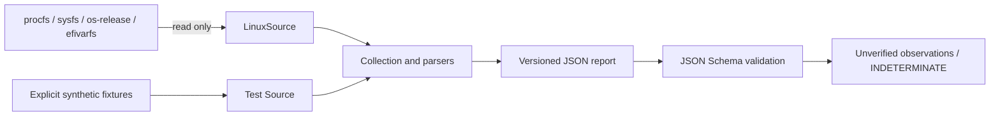
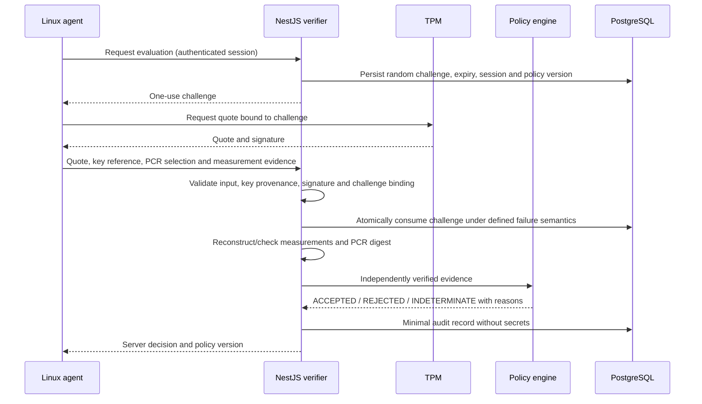

# Architecture

## Implemented flow

`apps/agent/src/lib.rs` separates the `Source` interface from collection and
parsing. `LinuxSource` reads fixed system paths, enumerates TPM class names and
probes selected interfaces. Test sources never touch hardware and identify their
origin as synthetic. The CLI only selects live reads and prints JSON; it cannot
load a fixture or request privileges.

`Observation<T>` makes successful, missing and failed reads explicit. The report
keeps all observations OS-declared and unverified. `evidence` contains only false
values. Read failures preserve partial inventory rather than aborting the whole
report. Runtime output errors still cause a nonzero exit.

The standalone Python validator checks the normative JSON Schema and input-size
limit. It does not evaluate security policy or authenticate a sender.

## Proposed future flow — not implemented

Before implementation, specify nonce entropy/TTL, authorization, transaction
semantics, duplicate/concurrent submissions, enrollment/revocation, PCR banks,
measurement coverage, policy distribution and retention. Successful signature
verification alone does not establish key provenance or trustworthy measurements.

Only the future server may produce ACCEPTED. It will mean compliance with a
particular experimental policy, never proof of cheat absence or Vanguard support.

## Decisions

| ID | Decision | Reason / consequence |
|---|---|---|
| ADR-001 | Rust for read-only inventory; serde and serde_json only runtime dependencies | Typed output and well-tested JSON escaping without shell commands |
| ADR-002 | Strict JSON Schema 2020-12; Python jsonschema for tests | Independent contract validation; Python not required by agent |
| ADR-003 (historical) | Original inventory iteration omitted verifier, PostgreSQL, Compose and dashboard | Superseded for the authorized verifier subset by ADR-009 through ADR-012 |
| ADR-004 | Do not open TPM devices or read complete event logs | Avoid unnecessary privileges/device commands and sensitive log collection |
| ADR-005 | All inventory is unverified; local result constant | No unsupported trust claims from boolean observations |
| ADR-006 | GitHub Actions with pinned action commits | Matches the public GitHub repository; no deployment needed |
| ADR-007 | Apache-2.0 | Broad reuse and contribution with explicit patent terms; no trademark license |
| ADR-008 | English throughout | Community participation, per the user's updated language preference |

The initial eight-week roadmap is planning, not evidence of completion.

## Phase 2 laboratory boundary

The agent and inventory-v1 remain unchanged. An external laboratory procedure
deploys a prebuilt, checksummed static musl binary and runs it separately under
ordinary and explicitly privileged execution. TPM tools run outside the agent.
Their PCR reads are collected measurements, not signed or verified evidence.
Infrastructure configuration and raw reports remain private.

Separate draft submission/result schemas and the [enrollment design](ENROLLMENT_DESIGN.md)
prepare Phase 3. Schema tests exercise shapes and decision consistency, not
cryptographic verification. No deployed runtime path can issue ACCEPTED for live evidence.

## Phase 3 implemented subset

The local NestJS verifier uses strict route input validation, separate admin/client
credentials and PostgreSQL persistence. An atomic conditional UPDATE consumes a
challenge before quote processing; result persistence uses a separate transaction
with a final locked revocation check. A failure cannot reopen a challenge.
The server checks real TPMS_ATTEST signatures, signed qualifying data and PCR
digest binding, then independently evaluates a versioned policy. It currently
cannot accept any live platform because provenance, coverage and approved baseline
checks remain unavailable. The sequence above still includes unimplemented
provenance and event-log reconstruction steps.

ADR-009: explicit parameterized SQL through pg instead of an ORM for the small
state machine; real PostgreSQL concurrency tests verify reservation behavior.
ADR-010: Node/OpenSSL verifies RSA signatures; bounded TPM decoding is isolated
from HTTP/database logic and must receive independent security review.
ADR-011: loopback-only single-client lab API; no automatic production deployment.
ADR-012: NULL-hierarchy temporary signing key demonstrates real quote verification
without persistent enrollment; it is always registered as UNPROVEN.

The executable route contract supersedes the historical draft for this limited
protocol; see [verifier documentation](../apps/verifier-api/README.md).

## Consolidation Phase 1

The [implemented protocol](PROTOCOL_V1.md) separates executable HTTP v1 from the
historical draft. Typed responses and HTTP tests preserve that boundary. Policy
acceptance requires all six mandatory checks; nonce/PCR comparisons are only
VERIFIED after signature verification. Startup requires the migration row and
cleans up resources on failure. See [results](RESULTS_CONSOLIDATION_PHASE_1.md).
